# Manual de uso — SodApp

SodApp es la aplicación para gestionar el reparto de agua y soda: ventas, clientes, deudas, inventario, agenda de reparto y caja mensual.

**Contenido**

1. [Ingreso a la aplicación](#1-ingreso-a-la-aplicación)
2. [Pantalla principal y navegación](#2-pantalla-principal-y-navegación)
3. [Ventas](#3-ventas)
4. [Agenda de reparto](#4-agenda-de-reparto)
5. [Clientes](#5-clientes)
6. [Deuda del cliente](#6-deuda-del-cliente)
7. [Productos e inventario](#7-productos-e-inventario)
8. [Caja: ventas y cobros](#8-caja-ventas-y-cobros)
9. [Modo oscuro, datos de la empresa y mensajes](#9-modo-oscuro-datos-de-la-empresa-y-mensajes)
10. [Preguntas frecuentes](#10-preguntas-frecuentes)

> **Importante:** todas las acciones de guardar, cargar, saldar, eliminar o actualizar stock modifican los datos reales del negocio en el servidor. Revise los datos antes de confirmar.

---

## 1. Ingreso a la aplicación

Al abrir SodApp por primera vez se muestra la pantalla de ingreso.

1. Escriba su **Nombre de usuario**.
2. Escriba su **Contraseña**. El ícono del ojo, a la derecha, permite mostrarla u ocultarla.
3. Presione **Login**.

  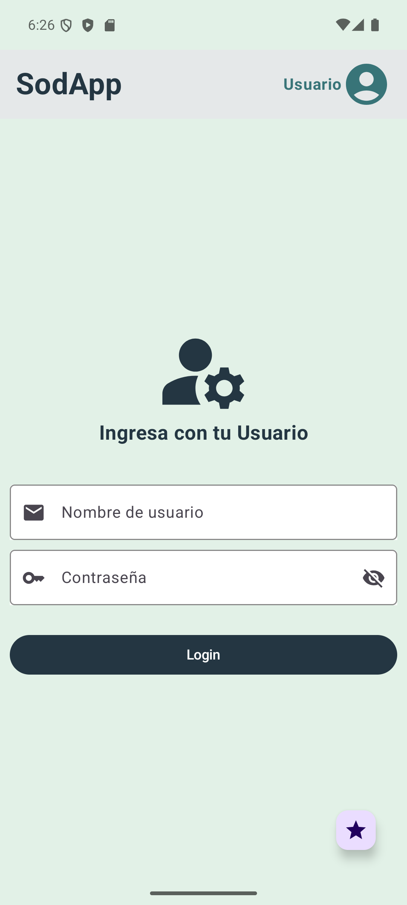
  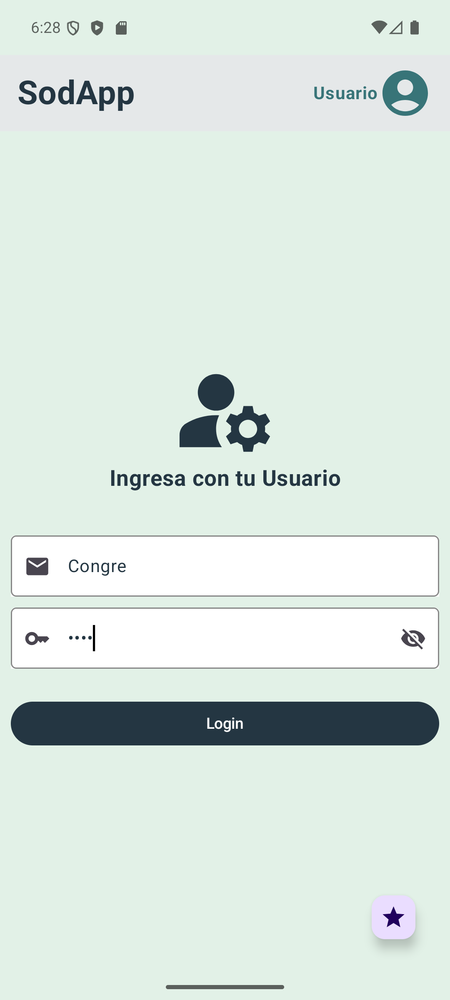

La sesión queda guardada en el teléfono: la próxima vez que abra la aplicación entrará directamente a la pantalla principal. Para cerrar la sesión abra el menú de los **tres puntitos** (⋮), en la esquina superior derecha de la pantalla principal, y elija **Salir**.

---

## 2. Pantalla principal y navegación

La pantalla principal tiene tres zonas:

- **Encabezado:** logo de SodApp, el nombre del usuario conectado y el botón de los **tres puntitos** (⋮).
- **Contenido:** la sección seleccionada.
- **Barra inferior:** cuatro secciones. La sección activa se resalta en violeta junto con su nombre.

| Ícono | Sección | Para qué sirve |
|-------|---------|----------------|
| Lista | **Ventas** | Cargar ventas y ver las ventas cargadas. Es la sección inicial. |
| Persona con "+" | **Clientes** | Alta, búsqueda, edición, días de entrega y deuda de clientes. |
| Bandeja | **Inventario** | Alta y edición de productos, control de stock. |
| Bolsa de dinero | **Caja** | Ventas y cobros por día, semana o mes. |

El botón de los **tres puntitos** (⋮) del encabezado abre un menú para cambiar entre modo claro y modo oscuro, cerrar la sesión con **Salir** y, si es el dueño de la empresa, para cargar los datos de la empresa, personalizar los mensajes de WhatsApp y administrar los **Usuarios y roles** (ver [sección 9](#9-modo-oscuro-datos-de-la-empresa-y-mensajes)).

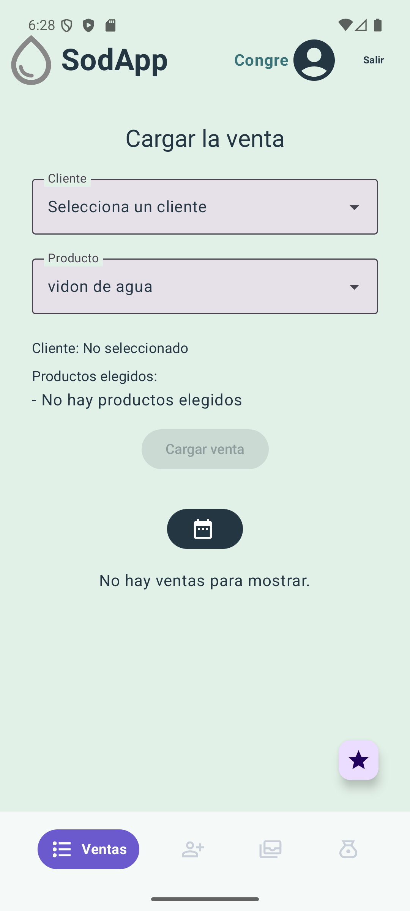

---

## 3. Ventas

### 3.1 Cargar una venta

1. En **Cliente**, despliegue la lista y elija el cliente. La lista está ordenada alfabéticamente; deslice para ver más nombres.
2. En **Producto**, elija el producto vendido. Cada producto elegido se agrega a **Productos elegidos**.
3. Ajuste la cantidad de cada producto con los botones **−** y **+**, o escriba la cantidad directamente.
   - Si el producto es **retornable** (ver [7.4](#74-envases-retornables)), debajo aparece **Envases devueltos**: indique cuántos envases vacíos le devuelve el cliente (por defecto 0). Los productos no retornables no muestran este campo.
4. Repita el paso 2 si la venta incluye varios productos.
5. Verifique el cliente y los productos y presione **Cargar venta**.

  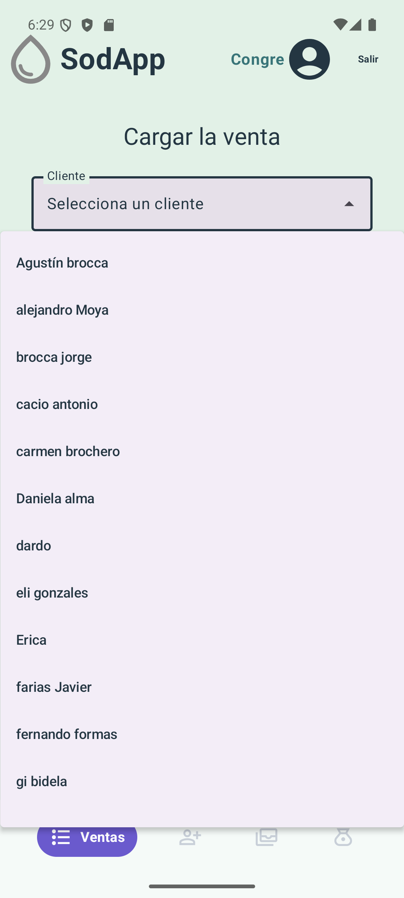
  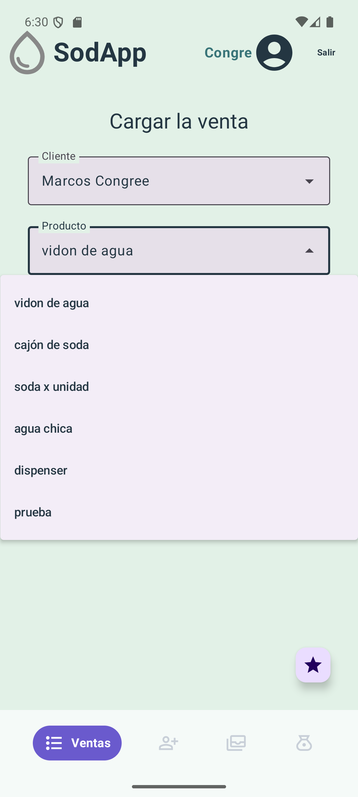
  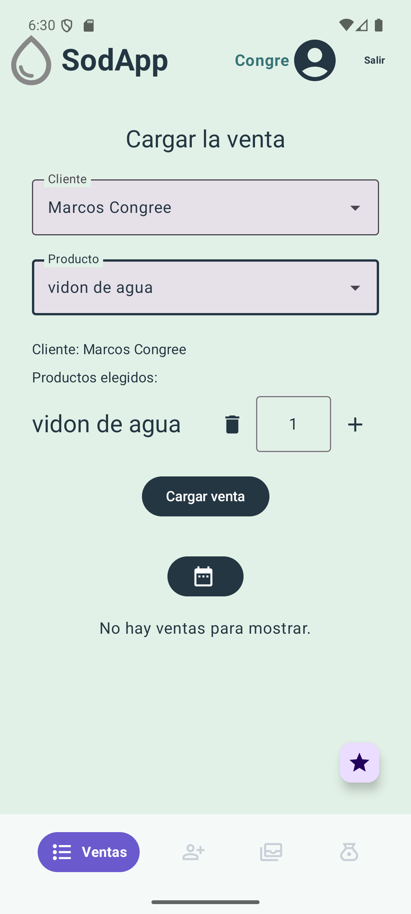

El botón **Cargar venta** permanece deshabilitado (gris) hasta que haya un cliente y al menos un producto elegidos.

Si la venta se registró, aparece el mensaje **"Venta cargada correctamente"**, el formulario se limpia y la venta aparece en el listado y en las últimas compras del cliente.

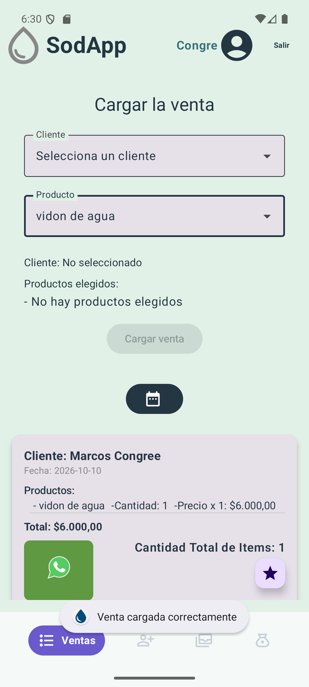

### 3.2 Listado de ventas y envío por WhatsApp

Debajo del formulario se listan las ventas cargadas. Cada tarjeta muestra el cliente, la fecha, los productos con cantidad y precio unitario, el total y la cantidad total de ítems.

El botón verde de **WhatsApp** abre WhatsApp con un resumen de la venta, listo para enviar al cliente. El mensaje va firmado con el nombre de la empresa (ver [Datos de la empresa](#92-datos-de-la-empresa)); mientras no esté cargado, se firma con el nombre del usuario. Si el dueño personalizó el mensaje de **Venta** (ver [Mensajes de WhatsApp](#93-mensajes-de-whatsapp)), se usa ese texto.

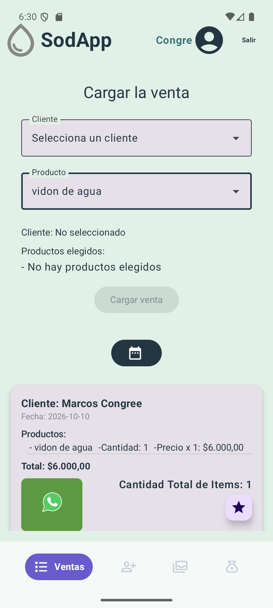

El botón con el **calendario**, debajo de **Cargar venta**, abre la [Agenda de reparto](#4-agenda-de-reparto).

---

## 4. Agenda de reparto

Muestra los clientes que tienen entrega programada en un día de la semana.

1. Desde **Ventas**, presione el botón del **calendario**.
2. Al abrir, se muestra el día actual. Para ver otro día, elíjalo en **Día de la semana**.
3. Cada tarjeta indica el nombre del cliente, la dirección y todos sus días de entrega.

  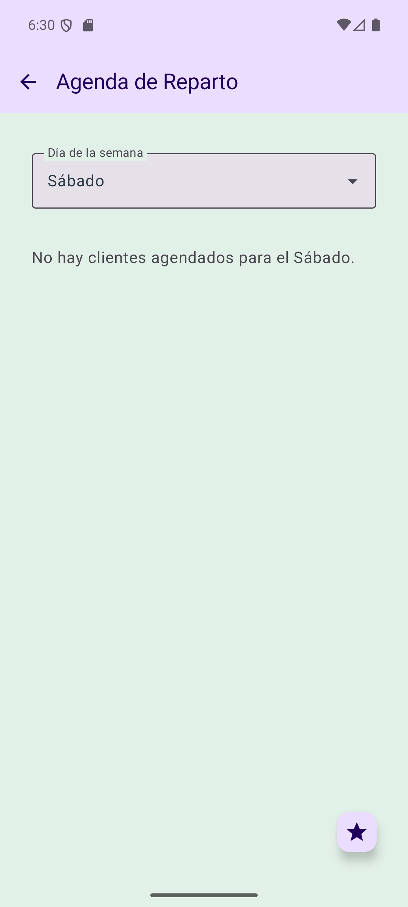
  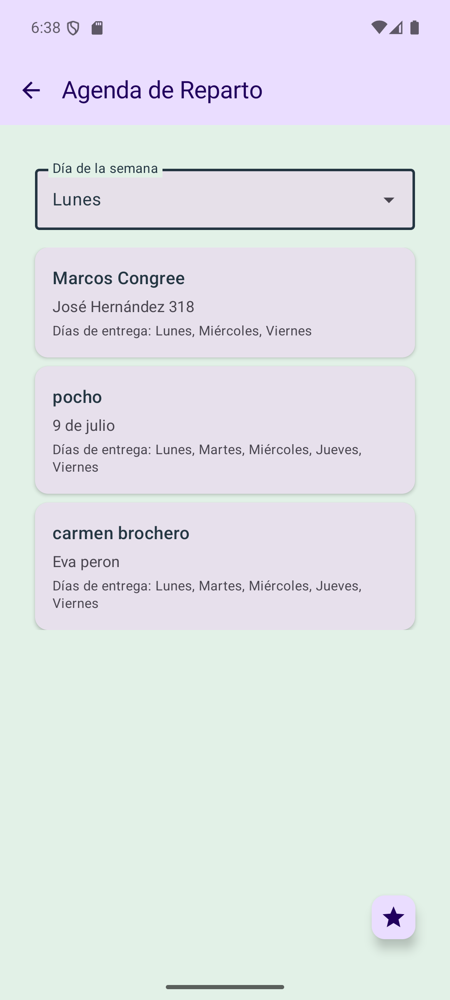

Los días de entrega de cada cliente se configuran desde **Clientes** (ver [5.3](#53-días-de-entrega)). Para volver, use la flecha **←** de la parte superior.

### 4.1 Armar el reparto de una fecha

El reparto es la lista de entregas de una fecha concreta, en el orden en que se van a visitar. Armarlo o modificarlo **no** descuenta stock ni suma deuda: eso pasa recién al entregar (ver [4.2](#42-entregar-y-cobrar)).

1. Desde **Ventas**, presione **Repartos**. Se abre el día actual; cambie de fecha con las flechas **‹** y **›**.
2. Si la fecha no tiene reparto, elija desde dónde crearlo:
   - **Plantilla del día**: la plantilla guardada para ese día de la semana (clientes, productos, cantidades y orden).
   - **Reparto anterior del mismo día**: copia el último reparto de ese día de la semana (por ejemplo, el lunes anterior).
   - **Clientes con entrega ese día**: una parada por cada cliente que tiene ese día de entrega, sin productos.
   - **Vacío**: un reparto sin paradas.

   Al copiar una plantilla o un reparto anterior, cada producto toma el **precio actual**.
3. Cada parada muestra el número de orden, el cliente, su **dirección**, el estado y los productos planificados.
4. Mientras la parada está **Pendiente** puede:
   - Cambiar el orden con las flechas **▲** y **▼**. El orden queda guardado.
   - Cargar los productos con el lápiz: cantidad y precio por producto. Si deja el precio vacío, se usa el precio del producto. Los productos con cantidad vacía o 0 no se agregan.
   - Quitar la parada con el tacho.
5. Para sumar un cliente, elíjalo en **Agregar parada**. Puede agregar cualquier cliente, aunque ese día no sea su día de entrega.
6. **Guardar como plantilla de los …** guarda el reparto como plantilla de ese día de la semana y reemplaza la anterior.

### 4.2 Entregar y cobrar

1. En la parada, presione **Entregar**. Se muestran los productos planificados con su cantidad y, debajo, el resto de los productos.
2. Ajuste lo que realmente entregó: cambie cantidades, cargue productos que el cliente pidió en el momento y, en los retornables, los **Devueltos**. Deje en 0 lo que no entregó.
3. Presione **Confirmar entrega**. Recién ahí se registran las ventas: se descuenta el stock, se suma la deuda del cliente y se actualizan sus envases, igual que una venta cargada desde **Ventas**.
4. Se abre el cobro con el monto entregado ya cargado. Elija la forma de pago y presione **Saldar**, o cambie el monto (puede cobrar también deuda anterior). Si no cobra en ese momento, presione **Cerrar**.

Si no pudo entregar, presione **No entregada**: la parada queda registrada y no cambia stock ni deuda. Si vuelve más tarde ese mismo día, presione **Reabrir** y entréguela normalmente.

Una parada **Entregada** ya no se puede modificar. Para corregir un error, elimine la venta con la **X** en las compras del cliente (ver [6.2](#62-compras-y-pagos)).

### 4.3 Ruta en Google Maps

Arriba de las paradas, la tarjeta **Ruta en Google Maps** abre el recorrido en la aplicación Google Maps, en el orden en que armó el reparto. No tiene costo.

1. La primera vez, presione **Configurar planta** y cargue la **Dirección de la planta** y su **Localidad**. Desde ahí sale y ahí vuelve cada ruta. Se configura una sola vez.
2. Presione **Tramo 1**. Google Maps abre la ruta desde donde está usted, por las paradas **pendientes**, hasta la planta.
3. Google Maps acepta hasta 10 paradas por vez. Si el reparto tiene más, aparecen varios tramos (**Tramo 1 (paradas 1-10)**, **Tramo 2 (paradas 11-20 y planta)**…). Al terminar un tramo, vuelva a SodApp y abra el siguiente: empieza donde terminó el anterior.
4. Las paradas ya entregadas o no entregadas no se incluyen. Si reordena o entrega paradas, los tramos se actualizan solos.

**Tiempo del recorrido.** Al abrir el primer tramo se registra la hora de salida (**Recorrido iniciado a las …**). Cuando todas las paradas estén entregadas o marcadas como no entregadas, presione **Llegué a planta**: se guarda la hora de llegada y se muestra la duración, por ejemplo **Recorrido: 3 h 25 min**.

Para que Google Maps llegue a la puerta correcta, cada cliente necesita la dirección completa (calle, número y localidad) o, mejor, su ubicación guardada (ver [5.7](#57-ubicación-del-cliente)).

**Clientes sin ubicación guardada.** Si Google Maps no encuentra la dirección escrita de un solo cliente, el tramo entero falla: Maps muestra solo el destino y se saltea todas las paradas intermedias. Por eso la tarjeta de la ruta lista, en rojo, los clientes pendientes que no tienen ubicación guardada. Guárdeles la ubicación (ver [5.7](#57-ubicación-del-cliente)) y la ruta usará su posición exacta, que Maps siempre encuentra. Si un tramo abre con una sola parada, revise los clientes de esa lista.

---

## 5. Clientes

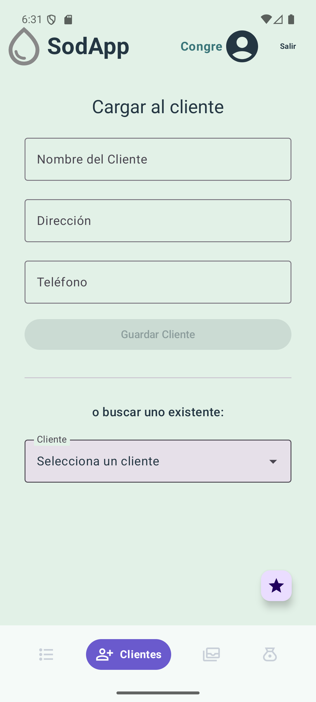

### 5.1 Dar de alta un cliente

1. Complete **Nombre del Cliente**, **Dirección** (calle y número), **Localidad** y **Teléfono**. La localidad es obligatoria.
2. Opcional: guarde la ubicación del cliente (ver [5.7](#57-ubicación-del-cliente)).
3. Presione **Guardar Cliente**.

### 5.2 Buscar un cliente existente

En **o buscar uno existente**, elija el cliente de la lista. Se muestra la tarjeta **Detalles del Cliente** con nombre, dirección, teléfono, deuda actual y cuatro botones:

| Botón | Acción |
|-------|--------|
| Lápiz | **Editar** los datos del cliente (5.4). |
| Carrito | Ver la **Deuda** y registrar pagos (sección 6). |
| Calendario | **Agendar** los días de entrega (5.3). |
| Papelera | **Eliminar** el cliente (5.5). |

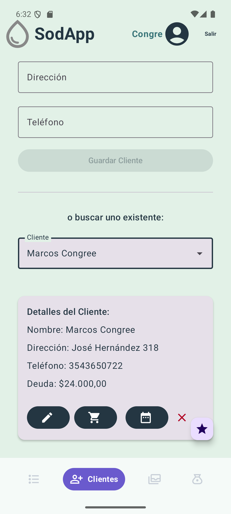

### 5.3 Días de entrega

1. En la tarjeta del cliente, presione el **calendario**.
2. Marque los días de la semana en que se le entrega (lunes a sábado).
3. Presione **Aceptar** para guardar o **Cancelar** para salir sin cambios.

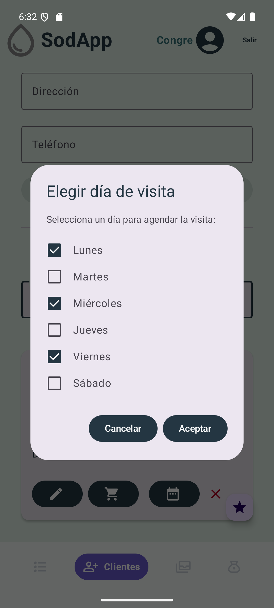

### 5.4 Editar un cliente

1. En la tarjeta del cliente, presione el **lápiz**.
2. Modifique **Nombre**, **Teléfono**, **Dirección**, **Localidad** o la ubicación.
3. Presione **Guardar**. Los clientes cargados antes de que existiera la localidad la piden la próxima vez que se editan: no se puede guardar sin ella. Para salir sin guardar, use la flecha **←**.

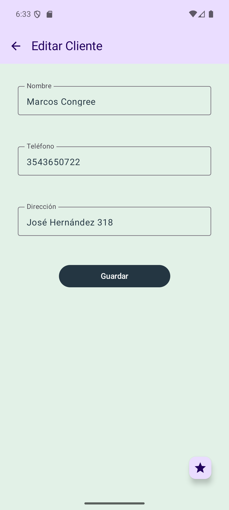

### 5.5 Eliminar un cliente

1. En la tarjeta del cliente, presione la **papelera**.
2. Confirme con **Eliminar**, o presione **Cancelar**.

> **Atención:** eliminar un cliente no se puede deshacer y borra sus datos del servidor.

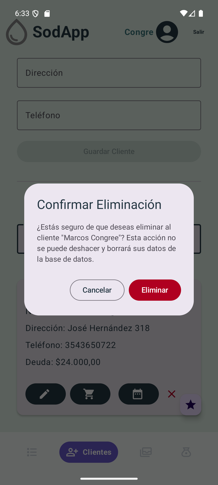

---

### 5.6 Cobros

La sección **Clientes** tiene dos pestañas: **Clientes** (alta, búsqueda y edición) y **Cobros**.

En **Cobros** se listan solo los clientes con saldo pendiente, del que más debe al que menos. Puede buscar un cliente por nombre en **Buscar cliente…**.

1. Toque el cliente que va a pagar. Se muestran su nombre y su **Saldo pendiente**.
2. Elija la **Forma de pago**: **Efectivo** o **Transferencia**.
3. Escriba el monto en **Ingrese monto**, o presione **Cobrar todo** para completar el saldo completo.
4. Presione **Saldar**. Aparece el aviso **"Pago registrado"** y el saldo se actualiza.

Si el cliente queda al día, desaparece de la lista. Para cobrarle a otro cliente, presione **Cambiar cliente**. Si no eligió una forma de pago, aparece el aviso **"Seleccione la forma de pago"** y el pago no se registra. Si el cliente paga una parte en efectivo y otra por transferencia, registre dos pagos.

### 5.7 Ubicación del cliente

La ubicación guardada hace que Google Maps lleve a la puerta exacta, aunque la dirección sea ambigua. Se carga en el alta o al editar el cliente, y también en la planta:

- **Guardar ubicación aquí**: parado en la puerta del cliente, toma la posición del GPS del teléfono. La primera vez el teléfono pide permiso de ubicación.
- **Ubicar por dirección**: busca la dirección y localidad escritas y muestra lo que encontró. Presione **Aceptar** solo si es la dirección correcta.
- **Quitar ubicación**: borra la ubicación guardada; la ruta vuelve a usar la dirección escrita.

## 6. Deuda del cliente

Se abre con el botón del **carrito** en la tarjeta del cliente. Muestra los datos del cliente y su deuda actual.

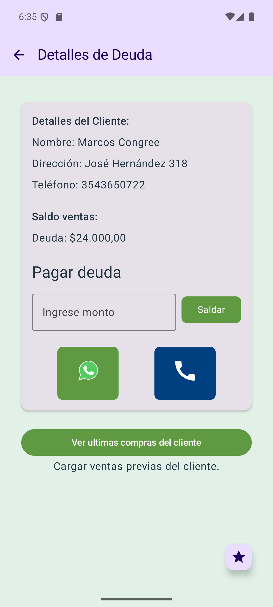

### 6.1 Registrar un pago

Los pagos se registran en **Clientes → pestaña Cobros** (ver [5.6 Cobros](#56-cobros)). En esta pantalla, el botón **Cobrar** lo lleva directamente a esa pestaña con el cliente ya elegido.

Debajo hay dos botones de contacto: uno abre el **marcador telefónico** con el número del cliente y otro, el de **WhatsApp**, abre un menú para elegir qué mensaje enviar, con una vista previa de cada uno:

- **Deuda**: el saldo de la cuenta del cliente.
- **Envases**: los envases retornables que el cliente tiene en su poder. Aparece deshabilitado si no tiene envases.
- **Venta**: el detalle de la última venta del cliente. Aparece deshabilitado si todavía no tiene ventas.

Al tocar un mensaje se abre WhatsApp con ese texto, listo para enviar.

### 6.2 Compras y pagos

Debajo de los datos del cliente hay dos pestañas:

- **Compras**: lista sus compras con producto, fecha, cantidad y precio.
- **Pagos**: lista los pagos registrados, del más reciente al más antiguo, con fecha, monto y forma de pago. Los pagos registrados con versiones anteriores de la aplicación aparecen con la forma de pago **Sin especificar**.

Cada compra tiene un botón **X** que elimina esa venta, descuenta su importe de la deuda del cliente y devuelve al stock las unidades vendidas. Si la venta tenía envases retornables, también se revierte su efecto en los envases del cliente y en los envases vacíos del depósito. Úselo solo para corregir ventas cargadas por error.

Si el cliente ya había pagado parte de esa venta, la deuda puede quedar negativa: ese importe es un **saldo a favor** del cliente. Por ejemplo:

| Paso | Deuda del cliente |
|---|---|
| El cliente compra por $10.000 | $10.000 |
| Paga $6.000 | $4.000 |
| Se elimina esa venta con la **X** | −$6.000 (saldo a favor) |

Los $6.000 que pagó por una venta que ya no existe quedan a su favor y se descuentan de sus próximas compras.

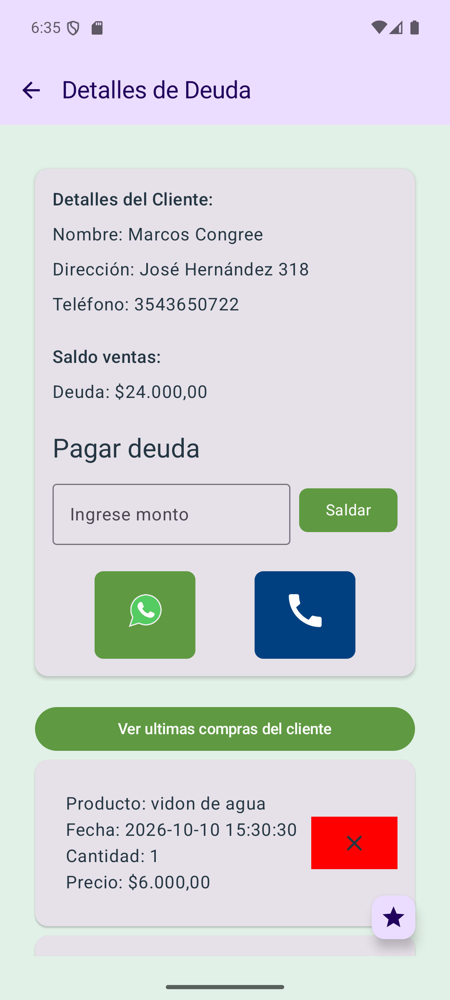

### 6.3 Envases del cliente

La tarjeta **Envases** muestra, por cada producto retornable, cuántos envases tiene el cliente en su poder. El saldo se actualiza solo con cada venta: suma los envases entregados y resta los **Envases devueltos**. Puede quedar negativo si el saldo inicial no se cargó.

Para cargar el saldo inicial o corregirlo, presione el **lápiz** del producto, escriba la cantidad actual de envases del cliente y presione **Guardar**.

Si el cliente tiene envases en su poder, el botón **Enviar** de WhatsApp abre WhatsApp con el recordatorio de envases, listo para enviar.

---

## 7. Productos e inventario

La sección **Inventario** tiene dos pestañas en la parte superior: **Productos** e **Inventario**.

### 7.1 Dar de alta un producto

En la pestaña **Productos**:

1. Complete **Nombre del Producto**, **Precio** y **Cantidad** (stock inicial).
2. Si el producto se entrega en un envase que el cliente devuelve (por ejemplo un bidón), active **Retornable** y, si corresponde, indique los **Envases vacíos** que hay en el depósito.
3. Presione **Guardar Producto**.

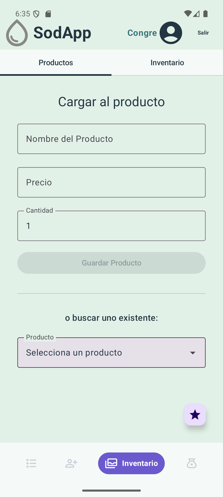

### 7.2 Consultar, editar o eliminar un producto

1. En **o buscar uno existente**, elija el producto. Se muestra su tarjeta con nombre, precio y cantidad en stock.
2. Presione **Editar** para cambiar el **Precio**, la **Cantidad**, la opción **Retornable** o los **Envases vacíos**, y luego **Guardar**.
3. Presione el botón de eliminar para borrar el producto. Se pide confirmación antes de borrarlo.

  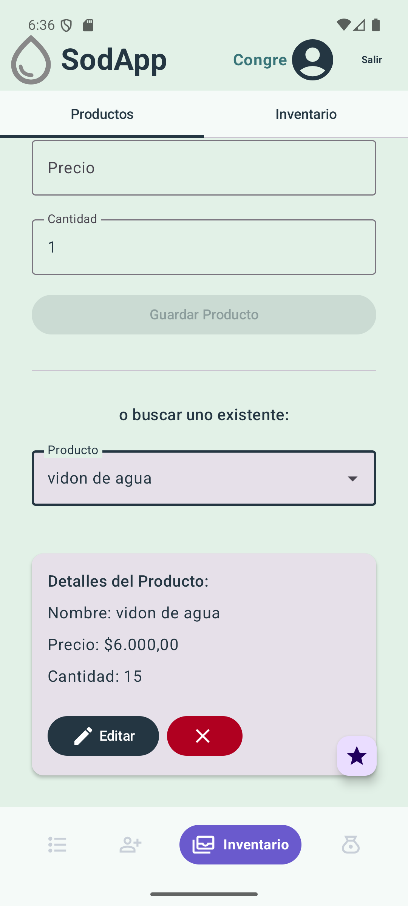
  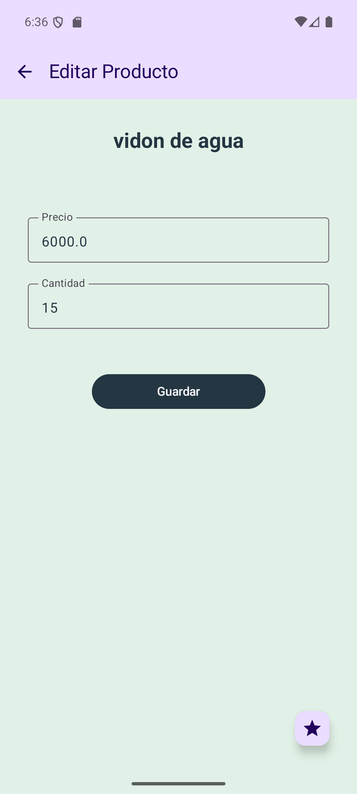

### 7.3 Actualizar el stock

En la pestaña **Inventario** se listan todos los productos con su precio y stock actual.

1. Use **Buscar producto…** para filtrar la lista.
2. Ajuste el stock de cada producto con **−** y **+**, o escriba la cantidad.
3. Cuando haya cambios pendientes aparece el botón **Actualizar stock**. Presiónelo para guardar todos los cambios juntos.

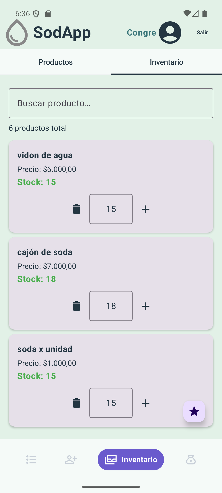

### 7.4 Envases retornables

En los productos retornables, el **stock** se muestra como **Envases llenos** (los envases llenos en el depósito) y **Envases vacíos** son los que volvieron de los clientes.

- Para sumar o corregir envases en la pestaña **Inventario**, elija primero **Llenos** o **Vacíos** sobre los botones **−** y **+**, ajuste la cantidad y presione **Actualizar stock** (llenos) o **Actualizar vacíos** (vacíos).

- Al cargar una venta, los **Envases devueltos** se suman a los envases vacíos del producto.
- Para rellenar envases, en la pestaña **Inventario** escriba la **Cantidad** junto a **Envases vacíos** del producto y presione **Llenar**: esa cantidad pasa de vacíos a stock lleno.
- Si no hay suficientes envases vacíos, se muestra **"No hay suficientes envases vacíos"** y no se modifica nada.
- El saldo de envases de cada cliente se consulta y corrige en la pantalla de deuda del cliente (ver [6.3](#63-envases-del-cliente)).
- En la pestaña **Inventario**, cada producto tiene un botón **Historial** que muestra sus movimientos de stock, del más nuevo al más viejo: **Venta**, **Venta eliminada**, **Llenado de envases**, **Ajuste manual** (al editar el stock del producto) y **Alta del producto**. Cada movimiento indica la fecha, la cantidad (+ o −) y el stock que quedó. El historial empieza a registrarse desde que se instala esta versión; los movimientos anteriores no aparecen.
- En la pestaña **Inventario**, cada producto retornable muestra también **Envases en clientes** (la suma de los saldos de envases de todos los clientes) y **Total de envases** (stock lleno + vacíos + en clientes). El total solo cambia cuando se corrige el stock, los vacíos o el saldo de un cliente; vender, recibir devoluciones o llenar envases lo mantiene igual.

---

## 8. Caja: ventas y cobros

Muestra cuánto se vendió y cuánto se cobró en un día, una semana o un mes.

1. Arriba elija **Día**, **Semana** (de lunes a domingo) o **Mes**.
2. Con las flechas **‹** y **›** pase al período anterior o al siguiente (no se puede avanzar a un período futuro). Toque la fecha del centro para elegir un día del calendario.
3. Los datos se cargan solos al cambiar el período.

Qué se muestra:

- **Vendido** y **Cobrado**, con la variación contra el período anterior (el día, la semana o el mes anterior).
- **Vendido − cobrado**: lo que quedó en cuenta corriente. Ventas y cobros no tienen por qué coincidir: una venta suma a la deuda del cliente y el cobro se registra cuando el cliente paga, que puede ser en otro período.
- **Ventas** (cantidad de ventas registradas), **Clientes** atendidos y **Ticket promedio** (vendido dividido por la cantidad de ventas).
- **Cobros por forma de pago**, con el porcentaje de cada una.
- **Ventas por día** (en semana y mes): toque una barra para ver el importe de ese día.
- **Productos** y **Clientes que más compraron**, ordenados por importe y con su porcentaje.
- **Detalle de ventas**: cada venta con cliente, fecha y hora; tóquela para ver los productos.

Avisos:

- Las ventas antiguas que no tienen el importe guardado se calculan con el precio actual del producto y se marcan con **\***.
- Si el período empieza antes del primer cobro registrado, se avisa que el total cobrado no está completo.
- Si el período anterior tiene cobros sin registrar, el cobrado no se compara y se muestra **Sin comparación: el período anterior tiene cobros sin registrar**.

**Exportar PDF** genera un PDF con todos los datos del período elegido y abre el menú para compartirlo (WhatsApp, correo, Drive, etc.).

Esta sección es solo de consulta: no modifica datos.

---

## 9. Modo oscuro, datos de la empresa y mensajes

El botón de los **tres puntitos** (⋮), arriba a la derecha de cada pantalla, abre un menú de opciones. El dueño de la empresa también encuentra ahí **Usuarios y roles**, y en la pantalla principal el menú termina con **Salir**, que cierra la sesión.

### 9.1 Modo oscuro

En el menú ⋮, elija **Pasar a modo oscuro** o **Pasar a modo claro**. La preferencia queda guardada en el teléfono. En la pantalla de ingreso el cambio se hace con el botón del sol o la luna.

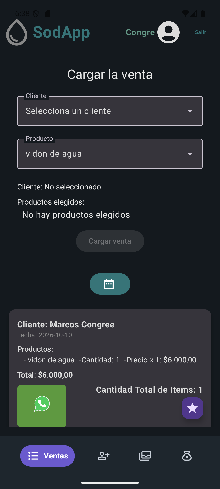

### 9.2 Datos de la empresa

Solo el dueño de la empresa ve la opción **Datos de la empresa** en el menú ⋮. Ahí se cargan:

- **Nombre de la empresa** (obligatorio, hasta 80 caracteres): el nombre real del negocio, distinto del usuario con el que se ingresa.
- **Teléfono** (opcional, hasta 30 caracteres: números, espacios, `+` y `-`).
- **Dirección** (opcional, hasta 150 caracteres).

Presione **Guardar**. Desde ese momento los mensajes de WhatsApp a los clientes van firmados con el nombre de la empresa, también los que envían los empleados (después de volver a ingresar o de reabrir la aplicación). Por ahora el mensaje lleva solo el nombre; el teléfono y la dirección quedan guardados para usos futuros.

### 9.3 Mensajes de WhatsApp

Solo el dueño de la empresa ve la opción **Mensajes de WhatsApp** en el menú ⋮. Ahí se personaliza el texto de los tres mensajes que se envían a los clientes:

- **Deuda**: el saldo de la cuenta. Variables: `{cliente}`, `{saldo}`, `{empresa}`.
- **Envases**: los envases retornables del cliente. Variables: `{cliente}`, `{envases}`, `{empresa}`.
- **Venta**: el detalle de una venta. Variables: `{cliente}`, `{productos}`, `{total}`, `{saldo}`, `{empresa}`.

Elija el mensaje con los botones de arriba y escriba el texto (hasta 1000 caracteres). Las variables se reemplazan al enviar por los datos de cada cliente: `{cliente}` es el nombre, `{saldo}` la línea del saldo (pendiente, a favor o al día), `{envases}` un renglón por envase, `{productos}` un renglón por producto con cantidad y precio, `{total}` el total de la venta y `{empresa}` el nombre de la empresa. Toque una variable para agregarla donde está el cursor. La **vista previa** muestra cómo queda el mensaje con datos de ejemplo.

Presione **Guardar**. Si el texto usa una variable que no corresponde a ese mensaje, la aplicación muestra un error y no lo guarda. **Restaurar mensaje por defecto** borra el texto personalizado y vuelve al mensaje original. Mientras un mensaje no esté personalizado, se usa el mensaje por defecto.

---

## 10. Preguntas frecuentes

**No veo mi nombre en el encabezado.**
Cuando la aplicación inicia con la sesión ya guardada, el nombre puede no mostrarse. Cierre la sesión con **Salir** (en el menú ⋮) y vuelva a ingresar.

**El botón "Cargar venta" está gris.**
Falta elegir un cliente o al menos un producto.

**Cargué una venta por error.**
Vaya a **Clientes → carrito (Deuda) → pestaña Compras** y elimine la venta con la **X**. La deuda se corrige automáticamente.

**El saldo de envases de un cliente no coincide con la realidad.**
Corríjalo en **Clientes → carrito (Deuda) → Envases** con el **lápiz** (ver [6.3](#63-envases-del-cliente)).

**Un cliente no aparece en la agenda.**
Revise que tenga días de entrega asignados en **Clientes → calendario**.

**La aplicación no carga datos.**
SodApp necesita conexión a internet. Verifique la conexión y vuelva a abrir la sección.
